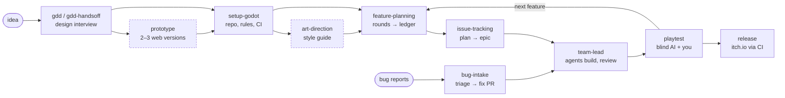

# game-ai-sdlc

**A development lifecycle for making games with AI agents, packaged as Claude Code plugins.**

Agents can design with you, build, test and even playtest a game. What they can't do is tell whether
it's fun. Only you can. So this process is built around one idea:

> **Keep your judgment cheap to give and final.** Agents do the work and find the facts; you make the
> calls, in short rounds of questions you can answer with "yes, except 3"; and nothing counts as
> accepted until you've played it.

It covers the whole path, from a one-line idea to a build on itch.io:



Two more skills run alongside everything: **`design-change`** for when you deliberately reverse a
decision, and **`docs-cleanup`**, which keeps the project's documents true at the end of every epic so
stale rules don't block new ideas.

---

## Install

### Claude Code

```text
/plugin marketplace add amramos/game-ai-sdlc
/plugin install game-sdlc@game-ai-sdlc
/plugin install game-sdlc-godot@game-ai-sdlc
```

From a local copy instead of GitHub: `/plugin marketplace add /path/to/game-ai-sdlc`.

| Plugin | What's in it |
|---|---|
| **`game-sdlc`** | The process, engine-agnostic: 17 skills and 2 agents |
| **`game-sdlc-godot`** | The Godot 4 engine pack: `setup-godot` and seven Godot workflow skills |

Skills are called as `/game-sdlc:<skill>` and `/game-sdlc-godot:<skill>`.

### Codex

Codex doesn't install Claude Code plugins, so copy the skills into Codex's skill folder:

```bash
python scripts/install_codex.py          # installs into ~/.codex/skills/
python scripts/install_codex.py --check  # are they up to date?
python scripts/install_codex.py --remove # uninstall (only what this script installed)
```

The projects `setup-godot` creates work with both clients: one shared `AGENTS.md`, the same hooks
registered for each, and the same three agent roles.

---

## Your first game, step by step

**1. Design it — `/game-sdlc:gdd`**

Start with a one-line idea, or nothing at all. The skill interviews you in rounds: genre, comparable
games, pitch, the rule that decides every cut, core loop, mechanics, art style, platforms. Every
question comes with a recommendation, so you can answer a round with "yes to all except 2". While you
answer, research agents look up comparable games and the market. You make every call. Anything you
leave undecided becomes an `[OPEN]` question instead of a quiet guess. Out comes `GDD.md`.

Don't want an interview? `/game-sdlc:gdd-handsoff` needs about 30 seconds of input: an idea (or
"surprise me"), a few games you love and one you find boring, and a scope. It drafts three different
concepts and you pick one; then an agent panel (a designer, a player advocate, a market analyst and a
skeptic from another model vendor) writes the GDD. Quality gates check that every mechanic serves the
governing rule, that the scope fits, and that the hook isn't a reskin. Blind AI playtesters then play
a quick prototype of the core loop, and the panel revises it if they don't get it or don't want
another round. You get a one-page summary: the pitch, the five decisions the panel assumed for you
(each with its runner-up), the playtesters' verdict, and the three likeliest ways the game fails.

**2. Try the core first — `/game-sdlc:prototype`** *(optional)*

It builds two or three throwaway browser prototypes, each taking a different approach to the core
mechanic. You play them, and so do blind AI playtesters, who play without ever seeing the design.
You pick one, the GDD is updated, and the rest are thrown away.

**3. Set up the repository — `/game-sdlc-godot:setup-godot`**

One round of questions (folder, Godot version, renderer, resolution, input, working style), which you
can answer with "use every recommendation". Then one list of everything it will do, and one yes. It:

- installs what's missing, including the export templates;
- creates a Godot project with `AGENTS.md` (the rules every agent follows, with your GDD's terms as
  its glossary), day-one decision records (ADRs), safety hooks for Claude and Codex, GUT tests, CI on
  every pull request, and an itch.io release workflow;
- proves the export presets with a real export, and boots the build;
- merges the scaffold into `main`, creates the private GitHub repository and pushes it.

It doesn't hand you a chore list. The hooks find Python, gdtoolkit and Godot on their own (no `PATH`
edits, no restarts), and itch.io setup waits for the first `release`. What's left for you is approving
the Godot MCP server the first time Claude Code opens the project.

Your **working style** (hands-off or interactive) is written into `AGENTS.md`, so every later skill
offers its next step in that style: after `gdd-handsoff`, the next feature is offered as
`feature-planning-handsoff`.

**4. Set the look — `/game-sdlc:art-direction`** *(optional)*

It generates two or three style directions as style frames (a scene, a character, a prop, a UI panel)
and you pick one. The frames, palette, sizes and the exact prompt are saved in `docs/art/`, and every
later asset is generated against them. It uses local ComfyUI (`comfyui-art`) first, then Codex image
generation, then Meshy.

In a hands-off project, a critic agent picks the direction instead. The pick is marked *assumed*, and
you're shown the chosen direction next to the runners-up: reply with another direction's name to swap.

**5. Plan a feature — `/game-sdlc:feature-planning <feature>`**

Rounds of questions about what the player will see and do, a walkthrough that includes a failure path,
sketches over real screenshots for layout decisions, and a list of ways the plan could pass and still
be wrong. You approve a short **decisions ledger**: every decision, who made it, and when. The long
technical plan is for the agents, and a reviewer checks that it contains every decision and invents
none.

Away from the keyboard? `/game-sdlc:feature-planning-handsoff` has a panel of agents (a designer, a
player advocate and a skeptic from another model vendor) answer the rounds instead. Decisions that are
really yours get marked *assumed*, so when you're back you read only those.

**6. Build it — `/game-sdlc:team-lead`**

The approved plan becomes an epic, with one feature per work package (`issue-tracking`, Linear or
GitHub Issues). A lead agent writes a brief, agrees the interfaces, and runs developer agents in
parallel. Each piece is reviewed adversarially by a model from another vendor as it lands, then the
lead playtests the result, runs every check, cleans the docs, and opens one pull request per feature.
You merge. The run ends with a short story page: who did what, pushback, disagreements, the results,
and how to try it yourself.

`/game-sdlc:team-lead-handsoff` merges reviewed work to `main` itself, behind a checklist (CI green,
reviewer approval, the exported build boots, a tag before every merge so it can be reverted).

**7. Play it — `/game-sdlc:playtest`**

A panel of blind AI playtesters plays the real window or the game's rules as text, and reports where
they got confused and what they'd want to play again. Then you play. Your findings become a document
that maps each finding to its fix and the test that now covers it.

**8. Ship it — `/game-sdlc:release playtest`** (or `public`)

It writes release notes from what merged since the last tag, pushes a tag, and CI exports every
platform, boots the exported build as a smoke test, and uploads to itch.io with butler. Playtest builds
go to a restricted page.

**And when bugs come in — `/game-sdlc:bug-intake`** sets up a pipeline once: a bug on GitHub or Linear
gets an agent's triage (reproduction, confidence, recommendation), and when you label it `agent-ready`,
a fix agent opens a pull request that starts from a failing test.

---

## All skills

| Skill | Plugin | Called by | What you get |
|---|---|---|---|
| `gdd` | game-sdlc | you | A GDD from a design interview with research |
| `gdd-handsoff` | game-sdlc | you | A provisional GDD from a 30-second intake, a concept pick and an agent panel |
| `gdd-core` | game-sdlc | the two above | The shared method (hidden from the menu) |
| `prototype` | game-sdlc | you | 2–3 web prototypes, played and compared |
| `setup-godot` | game-sdlc-godot | you | A Godot repo with rules, ADRs, hooks, GUT, CI, release |
| `art-direction` | game-sdlc | you | A style guide every asset is generated against |
| `comfyui-art` | game-sdlc | you or agents | Local image generation, cleaned onto the palette |
| `feature-planning` | game-sdlc | you | A plan and a decisions ledger you approve |
| `feature-planning-handsoff` | game-sdlc | you | The same, decided by an agent panel while you're away |
| `feature-planning-core` | game-sdlc | the two above | The shared method (hidden from the menu) |
| `issue-tracking` | game-sdlc | agents | Epic → Feature on Linear or GitHub, statuses kept current |
| `team-lead` | game-sdlc | you | An epic built by an agent team, as PRs for you to merge |
| `team-lead-handsoff` | game-sdlc | you | The same, merged to `main` behind a checklist |
| `playtest` | game-sdlc | you or agents | Blind AI playtest reports; your findings mapped to fixes |
| `release` | game-sdlc | you | A playtest or public build on itch.io |
| `bug-intake` | game-sdlc | you, once | Bugs triaged and fixed as PRs, automatically |
| `design-change` | game-sdlc | you | A deliberate reversal, with its cost stated and records closed |
| `docs-cleanup` | game-sdlc | agents | Docs kept true and short after every epic |
| `godot-plan`, `godot-feature-dev`, `godot-debug`, `godot-refactor`, `godot-architecture`, `godot-code-review`, `godot-scene-inspector` | game-sdlc-godot | agents | Godot-specific ways of working |

Agents: `team-developer` and `adversarial-reviewer` (in `game-sdlc`); `setup-godot` adds
`godot-developer`, `godot-debugger` and `godot-reviewer` to each project.

---

## The principles behind it

1. **You're the owner.** A direct instruction from you is the approval. An agent states the cost once,
   then builds it; repeating an objection you've already answered is a failure.
2. **Mechanism, not taste.** Rules may protect the repository (branches, typing, file formats). They
   never decide creative calls.
3. **Experience before mechanism.** You approve what the player sees and does, not a file list.
4. **Facts are found, decisions are asked.** Agents never ask you what they can look up.
5. **A green test suite is not acceptance.** Every gate is provisional until you've played it.
6. **A second opinion from another vendor's model.** It misses different things than the model that
   wrote the code.
7. **Docs are evidence, not law.** Every decision record says what would make it wrong; old text gets
   deleted, not appended to.
8. **Safety is code.** Hooks and CI enforce the rules that matter, so nobody has to remember them.

[docs/lifecycle.md](docs/lifecycle.md) explains each phase, and the failure that taught each practice.

---

## Optional tools the skills use when present

| Tool | Used by | Without it |
|---|---|---|
| [Codex CLI](https://github.com/openai/codex) and its Claude Code plugin | adversarial review, the skeptic panelist, image generation | a different Claude model reviews instead |
| [GitHub CLI](https://cli.github.com/) | PRs, releases, bug intake | the skills tell you the manual steps |
| Linear connector | issue-tracking, bug intake | GitHub Issues, or the plan in the repo |
| [ComfyUI](https://github.com/comfyanonymous/ComfyUI) + Z-Image Turbo | comfyui-art, art-direction | Codex images, then Meshy |
| [Meshy](https://www.meshy.ai/) (paid) | 3D art | 2D only; every paid call is confirmed first |
| [pixelforge](https://github.com/amramos/pixelforge) | palette and canvas lint for pixel art | no automatic palette check |
| [butler](https://itch.io/docs/butler/) | release (in CI, installed automatically) | — |

---

## This repository

```text
.claude-plugin/marketplace.json   the marketplace: two plugins
plugins/game-sdlc/                the process plugin (skills/, agents/)
plugins/game-sdlc-godot/          the Godot pack (setup-godot and its project-template/, godot-* skills)
scripts/install_codex.py          copy the skills into Codex
scripts/check_package.py          lint the package: manifests, frontmatter, links, leftovers
scripts/test_template.py          instantiate the Godot template and run its hook tests
scripts/tests/                    unit tests for the scripts
docs/lifecycle.md                 the phases, and why each practice exists
```

Before publishing a change:

```bash
python scripts/check_package.py
python -m unittest discover -s scripts/tests
python scripts/test_template.py
```

## Limits, honestly

- **Godot only, for now.** The process skills don't depend on the engine, but only Godot has a setup
  skill and a CI pipeline. Another engine is another pack (`setup-unity`, …).
- **Agents playing the real window need a bridge in your game**, to list click targets and take
  input, and headless text play needs your rules exposed as text. `playtest` describes both; the
  package doesn't ship a ready-made bridge yet.
- **Steam isn't automated.** `release` covers itch.io; Steam is described as a later step.
- **It grew out of one solo project** with one owner deciding. A team would need its own answer to
  "who is the owner".

## License

[MIT](LICENSE). Use it, change it, share it.
